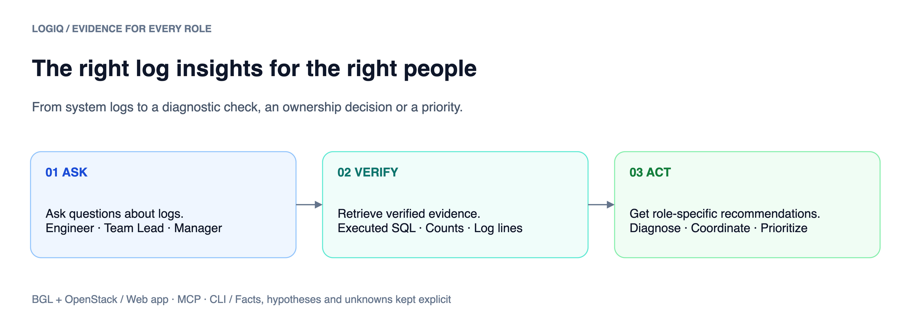
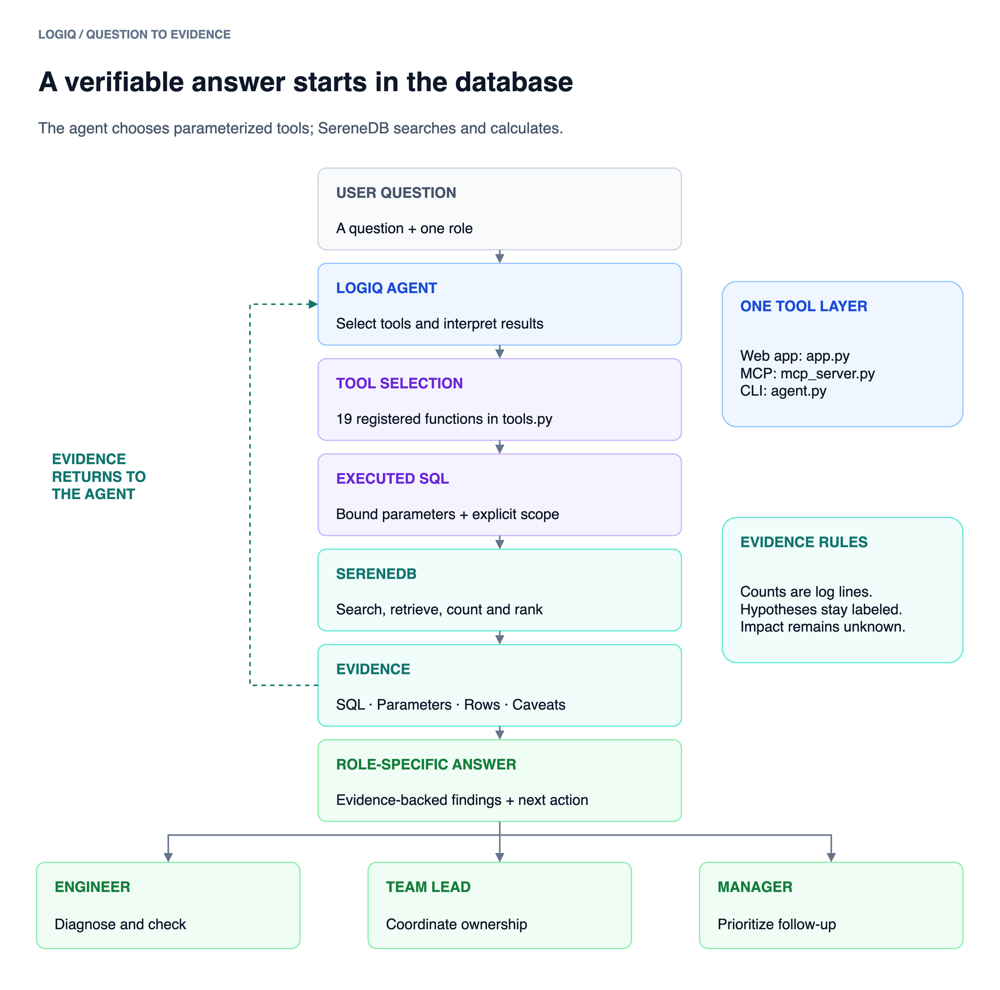
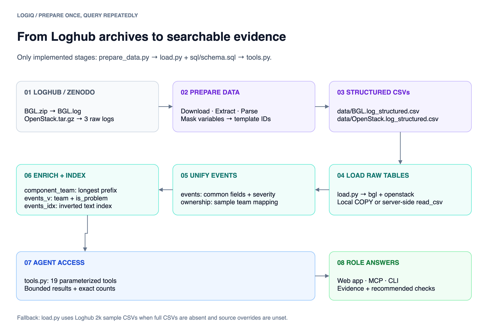

# LogIQ

**Ask questions about system logs. Get verifiable answers tailored to the person taking action.**



**Engineer** · Diagnose failures &nbsp; | &nbsp; **Team Lead** · Coordinate investigation &nbsp; | &nbsp; **Manager** · Prioritize risk

**[Run LogIQ](#quick-start)** · **[See the investigation](#worked-investigation)** · **[Explore all 19 tools](FUNCTIONS.md)** · **[Full reproduction guide](README_full_reference.md)**

## How it works



A question triggers **predefined tools**, which execute **parameterized SQL in SereneDB**. LogIQ interprets the returned evidence and provides a role-specific answer. It does **not** generate arbitrary SQL.



**Data:** 4,747,963 BGL log lines + 207,820 OpenStack log lines in the checked existing database. These are **log lines, not incident counts**.

## Tools: what goes in, what comes out

| Tool family | Accepted inputs (examples) | Returned outputs |
|---|---|---|
| **Search** | Dataset, text, time window, level, component, limit | Matching log lines, total matches, search evidence |
| **Investigate** | Dataset, event/line ID, context window | Nearby events, traceback or related context |
| **Aggregate** | Dataset, time window, grouping, filters | Counts, groups, time-series patterns |
| **Correlate** | Event/pattern, time window, scope | Related patterns and supporting counts |
| **Prioritize** | Dataset, period, ranking scope | Ranked risks, severity/frequency signals, caveats |

Every tool provides an **evidence envelope** with executed SQL, parameters, bounded results and limitations. **For the exact names, descriptions, accepted inputs and returned output schemas of all 19 tools, see [FUNCTIONS.md](FUNCTIONS.md).** The signatures in [`tools.py`](tools.py) are authoritative.

## Quick start

**Source:** a separate working-tree snapshot of `feature_docker`, without its Git history. Run setup commands from this directory. A public clone URL is not available yet.

**Requires:** Docker Compose v2.24+, Git, available ports **7890 / 8000 / 8001**, and a provider key for AI-generated answers. The tool explorer works without a model key.

```bash
cp .env.example .env
# Edit .env: configure one supported model provider.
docker compose config --quiet
docker compose up -d serenedb
# Wait until this returns 1:
docker compose exec -T serenedb psql -h 127.0.0.1 -p 7890 -U postgres -d postgres -c 'SELECT 1'
# FRESH / DISPOSABLE DATABASE ONLY: this rebuilds LogIQ tables.
docker compose run --rm --no-deps init
docker compose up -d --build --no-deps app mcp
curl --fail --silent --show-error http://localhost:8000/api/meta
```

**Open:** `http://localhost:8000` · **MCP:** `http://localhost:8001/mcp`

> **Already have a populated database?** **Skip `init`.** Start `serenedb`, wait for SQL readiness, then run `docker compose up -d --build --no-deps app mcp`. Running `init` again rebuilds tables and can destroy existing data. Full instructions: [reproduction guide](README_full_reference.md#existing-populated-database).

## Datasets and ingestion

LogIQ uses the full **Loghub BGL** supercomputer logs and **OpenStack** cloud infrastructure logs. The preparation script downloads these original archives from Zenodo:

| Dataset | Download source | Expected full-corpus records |
|---|---|---:|
| BGL | [BGL.zip](https://zenodo.org/records/8196385/files/BGL.zip?download=1) | **4,747,963** |
| OpenStack | [OpenStack.tar.gz](https://zenodo.org/records/8196385/files/OpenStack.tar.gz?download=1) | **207,820** |

**Raw logs, downloaded archives, and generated CSVs are deliberately excluded from GitHub.** They are large, reproducible artifacts; keeping them out avoids GitHub file-size limits and unnecessary repository growth. No Git LFS is used. The counts above were checked on the source project's populated database, not by running a new ingestion for this publication copy.

**Docker:** the Quick Start's `docker compose run --rm --no-deps init` installs dependencies and executes both scripts below automatically. It downloads archives, extracts raw logs, writes the structured CSVs into host `data/`, then loads SereneDB.

**Manual:** with Python 3.12+, dependencies installed, `.env` configured, and a fresh SQL-ready SereneDB database (see the [manual setup](README_full_reference.md#manual-environment)), run:

```bash
python prepare_data.py
python load.py
```

`prepare_data.py` downloads the two sources, extracts and parses raw logs, merges the three OpenStack files by timestamp, and writes `data/BGL.log_structured.csv` and `data/OpenStack.log_structured.csv`. `load.py` streams local CSVs, builds the schema/views/index, and prints dataset totals. **Loading drops and rebuilds LogIQ tables: skip it for a populated database you intend to preserve.** If the full CSVs are absent, the loader can fall back to 2k samples, which cannot reproduce this investigation.

Verify full counts after ingestion (Docker app running):

```bash
docker compose exec -T app python - <<'PYVERIFY'
import tools
counts = {d['dataset']: d['lines'] for d in tools.corpus_overview()['data']['datasets']}
assert counts == {'bgl': 4747963, 'openstack': 207820}, counts
print(counts)
PYVERIFY
```

Expected: the assertion passes and prints both totals. For manual setup, run the same Python with your activated environment instead of `docker compose exec -T app`.

**Attribution:** Zhu et al., *Loghub: A Large Collection of System Log Datasets for AI-driven Log Analytics*, ISSRE 2023. BGL: Oliner & Stearley, *What Supercomputers Say: A Study of Five System Logs*, DSN 2007.

## Worked investigation

**OpenStack disk inspection failure · May 16–17, 2017**

A background task attempted to inspect virtual machine disks with `qemu-img`. The captured diagnostic reported **“No such file or directory.”** LogIQ searched the records, aggregated the pattern, and generated different next steps for each role.

| Evidence from the recorded run | What it means |
|---|---|
| **8** `InvalidDiskInfo` matches | Observed exception log lines |
| **24** `qemu-img` matches | Related search results |
| **192** component ERROR lines | Aggregated `oslo_service.periodic_task` log lines |
| **Unassigned** | No matching owner in the sample ownership map |
| **2** identity-service CRITICAL lines | Separate high-severity signal to review |

**These counts overlap.** They are not additive and do not prove distinct incidents.

| Role | Question | Evidence-backed answer | Recommended action |
|---|---|---|---|
| **Engineer** | What failed? | Disk inspection failed; a referenced path was unavailable. | Check disk paths, image cache and instance lifecycle timing. |
| **Team Lead** | How widespread, and who owns it? | Repeated component errors; owner mapping is unassigned. | Assign an owner; coordinate compute and storage investigation. |
| **Manager** | What deserves attention? | Recurring disk errors plus a separate CRITICAL identity signal. | Prioritize follow-up by severity and scope; assign owners. |

**Established:** matching log lines, query counts, traceback context and missing-path diagnostic. **Not established:** confirmed root cause, independent incident count, affected hosts or customer impact. May 17 coverage is incomplete.

**[Visual investigation + each role's question, actual tool calls, executed SQL, parameters, results and actions](docs/worked_investigations/openstack_invaliddiskinfo_20261018T184344_296010Z/submission_report_illustrated.md)** · **[Raw execution evidence (JSONL)](docs/worked_investigations/openstack_invaliddiskinfo_20261018T184344_296010Z/evidence.jsonl)**

## Reproduce the evidence

| Step | Command or resource | Success criterion |
|---|---|---|
| **1. Load full data** | Fresh-database setup above | `/api/meta` reports BGL and OpenStack; not just 2,000-row samples |
| **2. Verify counts** | [Full corpus assertion](README_full_reference.md#fresh-installation) | BGL **4,747,963**; OpenStack **207,820** |
| **3. Replay supported SQL tools** | [Read-only investigation script](README_full_reference.md#execute-the-worked-investigation-current-tools) | **8** exceptions; **24** `qemu-img` matches; **192** component ERROR lines; output in `reproduction/` |
| **4. Review tool/query evidence** | `reproduction/current-tools.jsonl` | Actual SQL, arguments and returned records are present |
| **5. Optional: regenerate role answers** | [Provider-backed run](README_full_reference.md#generate-new-role-specific-answers-optional-model-run) | New answer + event JSONL per role; may differ from saved run |

**Verification status:** selected read-only counts were checked against an **existing populated database**. A fresh Docker install and new model-backed answers were **not** validated for the documentation update. Both test modules are included. The source snapshot's restored suite runs but fails against this implementation; do not treat it or a zero-test run as a pass. [See full validation notes](README_full_reference.md#validation-status).

## Project reference

**[19-tool catalog](FUNCTIONS.md)** · **[Detailed setup, configuration and troubleshooting](README_full_reference.md)** · **[SQL schema](sql/schema.sql)** · **[Agent](agent.py)** · **[Tools](tools.py)** · **[Docker Compose](docker-compose.yml)**

<details>
<summary><strong>Safety and reproducibility notes</strong></summary>

- Use the **full prepared datasets** to reproduce the reported counts; the 2k sample fallback will not match.
- The saved investigation and current `feature_docker` tool signatures differ. The reproduction script uses **currently supported calls**; it is not a byte-for-byte replay of the historical run.
- Do not infer a confirmed cause, downtime, customer impact, or eight independent incidents from these logs.
- Keep `.env` and provider credentials private. Use `docker compose down` to stop services; **do not** use `docker compose down -v` unless you intend to delete the database volume.
- Diagram images must be committed alongside this README at `docs/assets/` for GitHub to render them.

</details>
